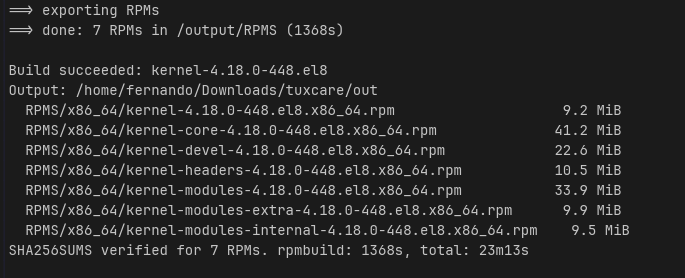

# CentOS Stream 8 Kernel Build, Patch Backporting, and Prompt Validation

Solution to the Kernel Developer test assignment. The target is the CentOS
Stream 8 kernel SRPM `kernel-4.18.0-448.el8.src.rpm`.

| Task | Status | Section |
|---|---|---|
| 1. Build the kernel SRPM in Docker | ✅ Done | [Task 1](#task-1--build-the-kernel-srpm-in-docker) |
| 2. Go build tool | ✅ Done | [Task 2](#task-2--go-build-tool) |
| 3. Backport security fixes and rebuild | ✅ 8 of 8 (`cvefix8`) | [Task 3](#task-3--backport-security-fixes-and-rebuild) |
| 4. Improve and validate a backporting prompt | ✅ Done | [Task 4](#task-4--improve-and-validate-a-backporting-prompt) |

## Repository layout

```
docker/
  Dockerfile   CentOS Stream 8 build image (pinned by digest), build deps pre-installed
  vault.repo   BaseOS / AppStream / PowerTools repos on vault.centos.org
  build.sh     container entrypoint: validate SRPM, builddep, rpmbuild, export
  embed.go     embeds the three files above into the Go tool (Task 2)
cmd/build-stream8-kernel/   Go tool entry point (Task 2)
internal/                   Go tool packages: source, runner, verify, clean
go.mod
docs/                       evidence (screenshots, crash logs)
tests/                      CVE reproducers (Task 3)
README.md
```

---

## Task 1 — Build the kernel SRPM in Docker

### Design

- **Base image:** `quay.io/centos/centos:stream8`, pinned by digest. This
  gives the same distribution the SRPM targets, with the EL8 GCC 8 toolchain.
- **Repositories:** Stream 8 is EOL and `mirrorlist.centos.org` is gone, so
  the stock repo files are replaced by `vault.repo`, which points to
  `vault.centos.org`.
- **"Warm" image:** the image build downloads the reference SRPM, checks its
  SHA-256 and runs `dnf builddep` on it, so repeated builds don't hit the slow
  vault. `build.sh` runs `builddep` again at runtime against the SRPM being
  built. This is a no-op unless its `BuildRequires` changed, for example in a
  patched SRPM.
- **Unprivileged build:** `rpmbuild` runs as user `builder`. Only `builddep`
  runs as root.
- **Lean build:** only the base kernel is built. See
  [Build options](#build-options).

### Prerequisites

- An x86_64 Linux host with Docker (tested with Docker Engine 29.1 on Fedora 43).
- About 30 GB of free disk for the image and the build tree. RAM ≥ 8 GB.
- Network access to `quay.io` and `vault.centos.org`.

### Step 1 — Clone the repository

```sh
git clone <repo-url> stream8-kernel
cd stream8-kernel
```

### Step 2 — Build the builder image

```sh
docker build -t stream8-kernel-builder:latest docker/
```

This takes a few minutes, mostly for `dnf builddep` from the vault. To build
the image against a different reference SRPM, use
`--build-arg SRPM_URL=... --build-arg SRPM_SHA256=...`.

### Step 3 — Download the SRPM

```sh
mkdir -p in out/original
curl -fL -o in/kernel-4.18.0-448.el8.src.rpm \
  https://vault.centos.org/8-stream/BaseOS/Source/SPackages/kernel-4.18.0-448.el8.src.rpm
echo "0e0533ea6d03a7a35f5066e4b2bde617670acb0bcc2d92fe7fd6374109152a87  in/kernel-4.18.0-448.el8.src.rpm" \
  | sha256sum -c -
```

`in/` must contain exactly one `*.src.rpm`.

### Step 4 — Build the kernel

```sh
docker run --rm \
  -v "$PWD/in:/input:ro,Z" \
  -v "$PWD/out/original:/output:Z" \
  -e HOST_UID="$(id -u)" -e HOST_GID="$(id -g)" \
  -e IMAGE_REF="stream8-kernel-builder:latest@$(docker image inspect -f '{{.Id}}' stream8-kernel-builder:latest)" \
  stream8-kernel-builder:latest
```

- `:Z` relabels the volumes for SELinux (Fedora/RHEL hosts). Without it the
  container can't write to `/output`.
- `HOST_UID`/`HOST_GID` make the exported files owned by your user.
- `IMAGE_REF` is recorded in `manifest.txt` for traceability.

Reference run: **~23 min** on a 12-thread / 15 GB RAM host.

### Step 5 — Check the artifacts

```
out/original/
  RPMS/x86_64/
    kernel-4.18.0-448.el8.x86_64.rpm
    kernel-core-4.18.0-448.el8.x86_64.rpm
    kernel-modules-4.18.0-448.el8.x86_64.rpm
    kernel-modules-extra-4.18.0-448.el8.x86_64.rpm
    kernel-modules-internal-4.18.0-448.el8.x86_64.rpm
    kernel-devel-4.18.0-448.el8.x86_64.rpm
    kernel-headers-4.18.0-448.el8.x86_64.rpm
  build.log       full rpmbuild log
  manifest.txt    NVR, SRPM SHA-256, image, rpmbuild options, gcc/binutils, duration
  toolchain.txt   rpm -qa of the build container
  SHA256SUMS      checksums of the exported RPMs
```

```sh
cd out/original
sha256sum -c SHA256SUMS
cat manifest.txt
grep -n check-kabi build.log     # kABI symbol check ran
cd ../..
```

### Step 6 — Test the kernel in an AlmaLinux 8.10 VM

A RHEL8-compatible userspace is required. An EL9/EL10 guest (systemd,
dracut, XFS features, RPM dependencies) is not a meaningful target for a
4.18 EL8 kernel. The steps below use an **AlmaLinux 8.10** guest under
QEMU/KVM.

**6.1 — Disable Secure Boot in the VM (UEFI guests only).** The kernel is
signed with pesign's local "Red Hat Test Certificate" (see
[Notes](#notes-and-known-limitations)), which shim doesn't trust. Check with:

```sh
mokutil --sb-state
```

**6.2 — Copy the packages to the VM.** Only four of the seven RPMs are
needed:

```sh
scp out/original/RPMS/x86_64/{kernel,kernel-core,kernel-modules,kernel-modules-extra}-4.18.0-448.el8.x86_64.rpm \
    <user>@<vm-address>:~/
```

| RPM | Install? | Why |
|---|---|---|
| `kernel`, `kernel-core`, `kernel-modules` | yes | kernel image, initramfs, modules |
| `kernel-modules-extra` | yes | less common modules; several CVE subsystems live here |
| `kernel-devel` | optional | only for building external modules |
| `kernel-modules-internal` | no | in-tree test modules (kunit, livepatch) |
| `kernel-headers` | **no** | not install-only: it would *downgrade* the guest's headers package |

**6.3 — Install (in the VM).**

```sh
sudo dnf install ./kernel-*4.18.0-448.el8.x86_64.rpm
# if dnf refuses because 4.18.0-553 (newer) is installed:
sudo rpm -ivh ./kernel-*4.18.0-448.el8.x86_64.rpm
```

The kernel is install-only, so -448 is installed **alongside** the stock
AlmaLinux kernel. The package scriptlets generate the initramfs and the GRUB
entry.

**6.4 — Boot it.** Reboot and choose `4.18.0-448.el8.x86_64` in the GRUB
menu. To make it the default instead:

```sh
sudo grubby --set-default /boot/vmlinuz-4.18.0-448.el8.x86_64
```

**6.5 — Verify (in the VM).** Run as root. The output is also saved to
`/root/k448-check.txt`:

```sh
sudo bash -c '
{
echo "### uname -r";            uname -r
echo; echo "### rpm -qi kernel-core"
rpm -qi kernel-core-4.18.0-448.el8 | grep -E "^(Name|Version|Release|Build Host|Build Date|Signature)"
echo; echo "### kernel cmdline";  cat /proc/cmdline
echo; echo "### systemctl --failed"
systemctl --failed --no-pager
echo; echo "### journalctl -b -p err"
journalctl -b -p err --no-pager
echo; echo "### dmesg: oops / bug / call trace / warnings"
dmesg | grep -iE "oops|bug:|call trace|warning:|taint" || echo "(nothing found)"
echo; echo "### /proc/sys/kernel/tainted"
t=$(cat /proc/sys/kernel/tainted); echo "value: $t"
for i in $(seq 0 31); do [ $(( (t >> i) & 1 )) -eq 1 ] && echo "  bit $i set"; done
echo; echo "### modprobe (subsystems touched by the Task 3 CVEs)"
for m in udf sch_hfsc rtlwifi; do
  modprobe -v $m && echo "$m: OK" || echo "$m: FAILED"
done
lsmod | grep -E "^(udf|sch_hfsc|rtlwifi)"
echo; echo "### modinfo (module signature)"
modinfo udf | grep -E "^(filename|signer|sig_key|vermagic)"
} 2>&1 | tee /root/k448-check.txt
'
```

| Check | What it shows |
|---|---|
| `rpm -qi` | `Build Host` = build container ID and `Signature` = `(none)`: our build, not an official package with the same NVR |
| `/proc/cmdline` | booted from `vmlinuz-4.18.0-448.el8.x86_64` |
| `systemctl --failed --no-pager` | units that failed to start |
| `journalctl -b -p err --no-pager` | messages of priority `err` or worse in the current boot (`-b`) |
| `dmesg \| grep` | kernel oops, `BUG:`, call traces, warnings |
| `/proc/sys/kernel/tainted` | taint flags, decoded bit by bit (`0` = clean) |
| `modprobe -v` | modules of the CVE subsystems load, with their dependencies |
| `modinfo` | modules are signed with the build's module signing key |

**Rollback:** pick the `4.18.0-553` entry in GRUB, or
`sudo grubby --set-default /boot/vmlinuz-4.18.0-553*`.

### Result — original SRPM (AlmaLinux 8.10 guest, QEMU)

| Check | Result |
|---|---|
| `uname -r` | `4.18.0-448.el8.x86_64` |
| `rpm -qi kernel-core` | `Build Host: a7c60a6ff665` (build container), `Signature: (none)` |
| `/proc/cmdline` | `BOOT_IMAGE=(hd0,msdos1)/vmlinuz-4.18.0-448.el8.x86_64 ...` |
| `systemctl --failed` | `0 loaded units listed` |
| `journalctl -b -p err` | `-- No entries --` |
| `dmesg` oops / BUG / call trace / warnings | none |
| `tainted` | `0` |
| `modprobe udf`, `sch_hfsc`, `rtlwifi` | all OK (dependencies loaded too: `crc-itu-t`, `cfg80211`, `mac80211`, ...) |
| `modinfo udf` | `vermagic: 4.18.0-448.el8.x86_64 SMP mod_unload modversions`, `signer: CentOS kernel signing key` |

About the module signer: `CentOS kernel signing key` is only the subject
name. It comes from the SRPM's `x509.genkey` template
(`CN = CentOS kernel signing key`). The key pair is **generated during the
build** (`certs/signing_key.pem`) and exists only inside the build
container. It is not the official CentOS key. The kernel trusts it because
its certificate is built into the same kernel image, which is why the
modules load without tainting the kernel.

### Build options

Default `RPMBUILD_OPTS` (flags checked against the -448 `kernel.spec`):

| Option | Effect |
|---|---|
| `--with baseonly` | base kernel only: no debug kernel, perf, tools, bpftool, selftests, ipaclones |
| `--without debuginfo` | no `-debuginfo` packages |
| `--without kabidwchk` | skip the DWARF-based kABI check |

The symbol-CRC kABI check (`kabichk`) stays **on** on purpose: it flags
backports that change the exported kernel ABI.

| Variable | Default | Meaning |
|---|---|---|
| `RPMBUILD_OPTS` | lean build above | extra `rpmbuild` options |
| `JOBS` | `nproc` | make parallelism |
| `HOST_UID` / `HOST_GID` | `builder` (1000) | owner of exported files |
| `IMAGE_REF` | `unknown` | image reference written to `manifest.txt` |

### Exit codes (`build.sh`)

| Code | Meaning |
|---|---|
| 0 | success |
| 2 | invalid input: no or multiple SRPMs, bad digest/signature, not a source RPM |
| 3 | `dnf builddep` failed (vault unreachable?) |
| 4 | `rpmbuild` failed (see `build.log`) |
| 5 | export failed: output not writable, no RPMs produced |

### Notes and known limitations

- **Toolchain fidelity:** the vault holds the *final* Stream 8 package set
  (2024), not the January 2023 set -448 was originally built with. The exact
  toolchain is recorded in `manifest.txt` / `toolchain.txt` (gcc 8.5.0-22,
  binutils 2.30-123).
- **Secure Boot:** the spec's `%pesign` falls back to the local "Red Hat Test
  Certificate" because the CentOS signing keys aren't available.
- `-fdump-ipa-clones` is still passed with `--with baseonly`, because the spec
  sets `kpatch_kcflags` before the `baseonly` block clears `with_ipaclones`.
  This is harmless.
- Benign warnings from the upstream spec: `user/group mockbuild does not
  exist`, `File listed twice` (kunit/livepatch test modules).
- `kabi-dw` is installed in the image, so `kabidwchk` can in principle be
  re-enabled with `-e RPMBUILD_OPTS="--with baseonly --without debuginfo"`
  (not tested yet).

---

## Task 2 — Go build tool

`build-stream8-kernel` runs the Task 1 build end to end: it stages the SRPM,
makes sure the builder image exists, runs the container, and verifies the
exported artifacts on the host.

```
build-stream8-kernel [flags] <src.rpm|url> <outfolder>
build-stream8-kernel --clean [--dry-run] [folder...]
```

### Design

- **Docker CLI, not the SDK.** The tool runs `docker` through `os/exec`.
  It uses only the Go standard library, the commands are the ones documented
  in Task 1, and `--docker podman` is enough to switch runtimes.
- **Embedded build context.** `docker/Dockerfile`, `build.sh` and
  `vault.repo` are compiled into the binary (`go:embed`, `docker/embed.go`).
  The image tag is derived from their content, for example
  `stream8-kernel-builder:4d71bb02ac73`. If the image doesn't exist, the tool
  extracts the context to a temp dir and runs `docker build`. When the
  Dockerfile or `build.sh` change, the tag changes too, so a stale image is
  never used by mistake.
- **Input staging.** The SRPM is downloaded or copied into a private temp
  dir that is mounted as `/input`. It is always copied, never hard-linked,
  because the `:Z` SELinux relabel would otherwise change the label of the
  user's original file.
- **Safe output.** An outfolder that already holds results (`RPMS/`,
  `build.log`, `manifest.txt`, `SHA256SUMS`) is refused unless `--force`
  is given.
- **Ctrl+C.** Killing `docker run` doesn't stop the container, because bash
  as PID 1 ignores SIGINT. On SIGINT/SIGTERM the tool runs `docker rm -f` on
  the container it named.
- **Host-side verification.** After the build, the tool re-checks every RPM
  against `SHA256SUMS`, rejects unlisted RPMs, and requires `kernel`,
  `kernel-core` and `kernel-modules`.

```
cmd/build-stream8-kernel/   CLI: flags, orchestration, exit codes
internal/source/            URL vs file, download, copy, sha256
internal/runner/            docker CLI wrapper: version, image inspect, build, run, rm
internal/verify/            SHA256SUMS and required-package checks
internal/clean/             --clean: removes build artifacts only
docker/embed.go             embedded build context and content-hash image tag
```

### Build the tool

Requires Go ≥ 1.22 (tested with 1.26):

```sh
go test ./...
go build -o bin/build-stream8-kernel ./cmd/build-stream8-kernel
```

### Usage

From a URL, checking the expected hash:

```sh
./bin/build-stream8-kernel \
  --sha256 0e0533ea6d03a7a35f5066e4b2bde617670acb0bcc2d92fe7fd6374109152a87 \
  https://vault.centos.org/8-stream/BaseOS/Source/SPackages/kernel-4.18.0-448.el8.src.rpm \
  out/original
```

From a local file:

```sh
./bin/build-stream8-kernel kernel-4.18.0-448.el8.src.rpm out/original
```

The output folder has the same layout as in
[Task 1, Step 5](#step-5--check-the-artifacts). On success, the tool prints
the list of RPMs and the build time.

Clean build results:

```sh
./bin/build-stream8-kernel --clean --dry-run     # list what would be removed from ./out
./bin/build-stream8-kernel --clean               # clean everything under ./out
./bin/build-stream8-kernel --clean out/original  # clean only this folder
```

`--clean` only deletes the artifacts the tool writes (`RPMS/`, `build.log`,
`manifest.txt`, `toolchain.txt`, `SHA256SUMS`), in the given folder and in
any result folder nested below it. Other files are kept and listed as
`kept ... (not a build artifact)`. Folders left empty are removed. A folder
that doesn't exist is reported and skipped.

| Flag | Default | Meaning |
|---|---|---|
| `--sha256 HEX` | none | expected SHA-256 of the SRPM (file or URL) |
| `--jobs N` | `nproc` in the container | make parallelism |
| `--rpmbuild-opts "..."` | lean build (Task 1) | `rpmbuild` options |
| `--image REF` | content-hash tag | use an existing image instead of the embedded context |
| `--rebuild-image` | off | rebuild the builder image even if it exists |
| `--force` | off | write into an outfolder that already has results |
| `--quiet` | off | don't stream the build output (it is still saved to `build.log`) |
| `--docker BIN` | `docker` | container CLI |
| `--clean` | off | clean mode: positional arguments are folders to clean (default `./out`) |
| `--dry-run` | off | with `--clean`: only list what would be removed |

Flags can come before or after the positional arguments.

### Exit codes

Codes 2–5 are passed through from `build.sh` unchanged.

| Code | Meaning |
|---|---|
| 0 | success |
| 1 | usage error, or outfolder already has results (no `--force`) |
| 2 | invalid input: file missing or not a valid source RPM |
| 3 | build dependencies could not be installed |
| 4 | `rpmbuild` failed (the error shows the last 20 lines of `build.log`) |
| 5 | exporting artifacts failed |
| 6 | docker unavailable: CLI missing, daemon down, socket permission, image not found |
| 7 | download failed (HTTP error, network) or SHA-256 mismatch |
| 8 | `docker build` of the builder image failed |
| 9 | host-side verification of the artifacts failed |
| 10 | `--clean` could not remove some artifacts |
| 130 | interrupted (Ctrl+C); the container is removed |

### Tests

`go test ./...` covers:
- URL vs path detection, local copy (never a hard link), download through
  `httptest`, HTTP 404, checksum mismatch, and cleanup of the staging dir
  on failure;
- `SHA256SUMS` verification: OK, tampered RPM, unlisted RPM, missing
  required package (`kernel-modules-extra` must not count as
  `kernel-modules`);
- the embedded context matches `docker/`, the tag format, and that
  `build.sh` is executable;
- flag parsing, outfolder protection, and container exit code mapping;
- `--clean`: a single result folder, a tree with several results plus an
  unknown file (kept) and an empty folder (removed), a folder without
  results (untouched), dry run (nothing deleted), and invalid targets.

Smoke tests against the real Docker daemon:

| Scenario | Result |
|---|---|
| `-h` | exit 0 |
| one positional argument | exit 1 |
| outfolder with `build.log`, no `--force` | exit 1 |
| missing local file | exit 2 |
| garbage file named `.src.rpm` | exit 2, from `build.sh` (`SRPM integrity check failed`) |
| URL returning 404 | exit 7 (`HTTP 404 Not Found`) |
| wrong `--sha256` | exit 7 (`sha256 mismatch: expected ..., got ...`) |
| `--docker nodocker` | exit 6 (`"nodocker" not found in PATH`) |
| `--image nosuch:tag` | exit 6 |
| SIGINT during the build | container removed, none left in `docker ps -a` |
| first run with a new tag | `docker build` from the embedded context (layers cached) |
| `--clean --dry-run` on `out/` | `would remove 10 artifacts (276.2 MiB), 3 empty folders`, nothing deleted |
| `--clean` on the smoke-test folder | build logs removed, unrelated files kept, empty folders removed |
| `--clean /nonexistent` | `does not exist, nothing to clean`, exit 0 |
| `--dry-run` without `--clean` | exit 1 |

The original file's SELinux label was checked to be unchanged after a run.

### End-to-end result (URL input)

```sh
./bin/build-stream8-kernel \
  --sha256 0e0533ea6d03a7a35f5066e4b2bde617670acb0bcc2d92fe7fd6374109152a87 \
  https://vault.centos.org/8-stream/BaseOS/Source/SPackages/kernel-4.18.0-448.el8.src.rpm \
  out/tool-url
```

```
Build succeeded: kernel-4.18.0-448.el8
Output: /home/fernando/Downloads/tuxcare/out/tool-url
  RPMS/x86_64/kernel-4.18.0-448.el8.x86_64.rpm                    9.2 MiB
  RPMS/x86_64/kernel-core-4.18.0-448.el8.x86_64.rpm              41.2 MiB
  RPMS/x86_64/kernel-devel-4.18.0-448.el8.x86_64.rpm             22.6 MiB
  RPMS/x86_64/kernel-headers-4.18.0-448.el8.x86_64.rpm           10.5 MiB
  RPMS/x86_64/kernel-modules-4.18.0-448.el8.x86_64.rpm           33.9 MiB
  RPMS/x86_64/kernel-modules-extra-4.18.0-448.el8.x86_64.rpm      9.9 MiB
  RPMS/x86_64/kernel-modules-internal-4.18.0-448.el8.x86_64.rpm    9.5 MiB
SHA256SUMS verified for 7 RPMs. rpmbuild: 1406s, total: 24m55s
```

- The downloaded SRPM matched the expected SHA-256. The existing image
  (`stream8-kernel-builder:4d71bb02ac73`) was reused.
- The exported files are owned by the invoking user (uid/gid 1000).
- Compared with the Task 1 build (`out/original`): the RPM set is the same,
  and so are the file lists of `kernel-core` and `kernel-modules`. The RPM
  checksums differ as expected, because the build is not bit-for-bit
  reproducible (timestamps, and a module signing key generated per build).

### End-to-end result (local SRPM)

```sh
./bin/build-stream8-kernel kernel-4.18.0-448.el8.src.rpm out
```



The same 7 RPMs as the URL build. `SHA256SUMS` was verified on the host.
`rpmbuild` took 1368 s, 23m13s in total.

## Task 3 — Backport security fixes and rebuild

_All 8 CVEs are backported in `kernel-4.18.0-448.el8.cvefix8`. By level of
evidence:_
- _Reproducer that PASSes on `cvefix8` and FAILs (or, for hfsc, panics) on
  the original kernel:
  CVE-2025-37797, CVE-2024-26704, CVE-2022-50367, CVE-2022-48757._
- _Fix presence checked on both kernels: CVE-2024-58072._
- _Code analysis and build only: CVE-2023-52835, CVE-2024-50143,
  CVE-2024-36940._

### How a fix is added to the SRPM

The SRPM is unpacked in the builder container, so the same `rpm` and
toolchain are used, then the spec is edited and the SRPM rebuilt:

```sh
mkdir -p work/manual && cp kernel-4.18.0-448.el8.src.rpm work/manual/
docker run -it --rm --user builder --entrypoint bash \
  -v "$PWD/work/manual:/manual:Z" -w /manual stream8-kernel-builder:latest

# inside the container
echo '%_topdir /manual/rpmbuild' > ~/.rpmmacros
rpm -i kernel-4.18.0-448.el8.src.rpm            # -> rpmbuild/SPECS, rpmbuild/SOURCES
cd rpmbuild
P=1001-net_sched-hfsc-fix-uaf-in-class-handling.patch
curl -fsSL -o SOURCES/$P \
  "https://git.kernel.org/pub/scm/linux/kernel/git/stable/linux.git/patch/?id=3df275ef0a6ae181e8428a6589ef5d5231e58b5c"
# edit SPECS/kernel.spec (see the table below), then:
rpmbuild -bp --target x86_64 SPECS/kernel.spec  # %prep only: the patch applies
rpmbuild -bs SPECS/kernel.spec                  # -> SRPMS/kernel-4.18.0-448.el8.cve37797.src.rpm
exit

# on the host
./bin/build-stream8-kernel \
  work/manual/rpmbuild/SRPMS/kernel-4.18.0-448.el8.cve37797.src.rpm out/cve37797
```

| Spec change | Why |
|---|---|
| `# define buildid .local` → `%define buildid .cve37797` | release becomes `448.el8.cve37797`: the patched kernel has its own `uname -r` and installs alongside the original |
| `Patch1001: <file>` before `Patch999999` | declares the patch as a package source |
| `ApplyPatch <file>` in `%prep`, before `ApplyOptionalPatch linux-kernel-test.patch` | applies it with `patch -p1`; `ApplyPatch` refuses patches not declared as `PatchNNNN:` |
| `%changelog` entry with `{CVE-2025-37797}` | traceability: `rpm -q --changelog kernel-core-...` lists the CVE |

Further fixes go into the same unpacked tree: don't run `rpm -i` again,
because it overwrites the edited spec. Add the next `PatchNNNN`/`ApplyPatch`
pair and a new changelog entry, and rename `buildid`.

`ApplyPatch` checks the declaration with `grep -E "^Patch[0-9]+: $patch\$"`,
so trailing whitespace after the file name on the `PatchNNNN:` line makes
`%prep` fail with `not listed as a source patch in specfile`. Check with
`grep -n '[[:space:]]$' SPECS/kernel.spec`.

A single touched file can be compiled in seconds in the `rpmbuild -bp` tree,
before the ~23 min RPM build:

```sh
cd BUILD/kernel-4.18.0-448.el8/linux-4.18.0-448.el8.cve37797.x86_64
cp configs/kernel-4.18.0-x86_64.config .config && make -s olddefconfig
make -s -j$(nproc) net/sched/sch_hfsc.o     # ~6 s; no new warnings
```

### CVE-2025-37797 — net_sched: hfsc: UAF in `hfsc_change_class()`

| | |
|---|---|
| Upstream fix | `3df275ef0a6a` "net_sched: hfsc: Fix a UAF vulnerability in class handling" (v6.15) |
| Dependencies | none |
| Applies to -448 | cleanly; the pre-fix code is identical, and codel/netem (whose peek can drop packets) exist in 4.18 |
| Adaptation | none |
| Why it is correct on 4.18 | the fix only re-checks `cl->qdisc->q.qlen` after `qdisc_peek_len()`; both have the same semantics in 4.18 |

**Test** (`tests/cve-2025-37797.sh`): based on upstream tc-testing test
`a4c3` (commit `7629d1a04ad2`), adapted so that packets really reach the
hfsc class on 4.18: u32 filters steer traffic (drr drops unclassified
packets), pings go to non-local addresses (local ones leave through `lo`),
and integer ping timeouts are used (EL8 iputils). The script checks that the
bug precondition was reached (the netem queue was non-empty and the peek
emptied it). If it wasn't, it reports `INCONCLUSIVE`. Both kernels were
booted with `slub_debug=FZP`, because the RHEL kernel has no KASAN and a
use-after-free read is otherwise silent.

| Kernel (AlmaLinux 8.10 VM, `slub_debug=FZP`) | Result |
|---|---|
| `4.18.0-448.el8.cve37797` (patched) | `precondition reached`, then `PASS`: no kernel errors |
| `4.18.0-448.el8` (original) | kernel panic, kdump reboot. [Crash log](docs/cve-2025-37797-original-kernel-crash.txt): `general protection fault` in `rb_erase` ← `update_ed` ← `hfsc_change_class`, `RAX: 6b6b6b6b6b6b6b6b` |

`0x6b` is `POISON_FREE`: the kernel followed a pointer read from a freed
hfsc class. Sequence on the original kernel:
1. The peek empties the class and `hfsc_qlen_notify()` removes it from the
   eligible tree.
2. `hfsc_change_class()` still calls `update_ed()`, which re-inserts the
   **empty** class.
3. `tc class del` frees it while it is still linked.
4. The next `update_ed()` → `rb_erase()` walks the freed node.

The commit message describes the vttree (link-sharing) variant. This run
hit the eltree (real-time) variant of the same root cause, and the fix
covers both, because the re-check guards the whole update block.

### CVE-2024-26704 — ext4: double-free of blocks due to wrong `moved_len`

Fixes are accumulated in one SRPM. This one was added as `Patch1002` on top
of the hfsc fix, with `buildid` renamed to `.cvefix2`
(`kernel-4.18.0-448.el8.cvefix2`).

| | |
|---|---|
| Upstream fix | `55583e899a53` "ext4: fix double-free of blocks due to wrong extents moved_len" (v6.8) |
| Dependencies | none |
| Applies to -448 | cleanly; the pre-fix code is identical |
| Adaptation | none |
| Why it is correct on 4.18 | `move_extent_per_page()` returns `replaced_count` (the blocks swapped), which the fix accumulates per iteration; `EXT4_IOC_MOVE_EXT` sets `me.moved_len = 0` after `copy_from_user`, so the early `goto out` paths before the new `*moved_len = 0` never read user data |
| Note | the divide-by-zero in `mb_update_avg_fragment_size()` quoted in the commit doesn't exist in 4.18 (no such function); the double free itself does (`mballoc.c` "freeing already freed block") |

**Test** (`tests/cve-2024-26704.sh`) exercises the root cause
deterministically on a 64 MiB ext4 loop image (4 KiB blocks):
- `orig` has 4 written blocks followed by a hole up to 16 blocks, and
  `donor` has 16 written blocks;
- `EXT4_IOC_MOVE_EXT` over 16 blocks swaps blocks 0-3, then hits the hole
  at EOF and returns `-ENODATA` (the `goto out` inside the loop);
- the ioctl copies `moved_len` back even on error;
- moved blocks are counted **independently** of `moved_len`, from `orig`'s
  logical→physical mapping (`FIBMAP`) before and after. Move-extent is the
  defrag primitive: it swaps physical blocks and keeps the file content,
  which is also checked.

| Kernel (AlmaLinux 8.10 VM) | orig physical blocks 0-3 | blocks moved | `moved_len` | Result |
|---|---|---|---|---|
| `4.18.0-448.el8.cvefix2` (patched) | `1554-1557` → `1558-1561` (donor's) | 4 | **4** | `PASS` |
| `4.18.0-448.el8` (original) | `1554-1557` → `2066-2069` (donor's) | 4 | **0** | `FAIL` |

On the original kernel 4 blocks are moved but `moved_len` is 0, so the
`out:` block skips discarding the preallocations. That is the root cause
of the double free. `e2fsck` is clean on both kernels, because the test
does not set up a preallocation overlapping the moved blocks: it proves
the root cause, not the double-free symptom.

The hfsc test was re-run on `cvefix2` as a regression check:
`precondition reached`, then `PASS`.

### CVE-2022-50367 — fs: uninitialised inode on `security_inode_alloc()` failure

Added as `Patch1003` on top of the two previous fixes, with `buildid`
renamed to `.cvefix3` (`kernel-4.18.0-448.el8.cvefix3`).

| | |
|---|---|
| Upstream fix | `2e488f13755f` "fs: fix UAF/GPF bug in nilfs_mdt_destroy" (v6.0) |
| Dependencies | none |
| Applies to -448 | no, context only: RHEL has `inode->rh_reserved2 = 0;` right before the moved call |
| Adaptation | the patch was regenerated on the -448 tree (`git format-patch`, upstream authorship kept, backport note in the message); the `-`/`+` lines are identical to upstream |
| Why it is correct on 4.18 | nothing initialised after the old call site depends on `i_security`, and `selinux_inode_alloc_security()` only touches its own blob; on failure `alloc_inode()` calls `->destroy_inode()` directly (not `__destroy_inode()`), so no counter is unbalanced by moving `this_cpu_inc(nr_inodes)` after the call. XFS calls `inode_init_always()` directly: `xfs_inode_alloc()` just frees the object on error, and `xfs_reinit_inode()` now reinitialises the same fields on failure that it always did on success |
| Impact on -448 | `CONFIG_NILFS2_FS` is off, and a scan of the `->destroy_inode()` implementations under `fs/` found none in this config that reads the uninitialised fields, so the known crash is not reachable here; the fix is applied as hardening of generic VFS code |

Iteration check: `rpmbuild -bp` applies 1001-1003, and `make fs/inode.o`
builds with no warnings.

**Test** (`tests/cve-2022-50367.sh`) forces the failure with bpftrace:
the -448 kernel has `CONFIG_BPF_KPROBE_OVERRIDE=y` and BTF, and
`should_failslab()` is an error-injection point. While the test process is
inside `security_inode_alloc()` for an inode of a private tmpfs, the only
slab allocation (the LSM inode blob) returns `-ENOMEM`. The test reads
`i_data.a_ops` directly from the inode twice:
- when `shmem_alloc_inode()` returns the slab object (the stale value);
- when `alloc_inode()` passes the failed inode to `shmem_destroy_inode()`.

A fixed kernel shows `empty_aops` at the second point. An unfixed one still
shows the stale value (`shmem_aops` of a previous regular file). If the
stale value is already `empty_aops`, the two can't be told apart, and the
test says `INCONCLUSIVE`.

Pointers are compared as raw addresses against `/proc/kallsyms`, because
EL8 bpftrace's `ksym()` only knows text and weak symbols. It names both
`empty_aops` and `shmem_aops` after the nearest preceding weak symbol, and
the first run of the test gave a false FAIL on the patched kernel because
of that.

| Kernel (AlmaLinux 8.10 VM) | `a_ops` before init | `a_ops` at `destroy_inode` | Result |
|---|---|---|---|
| `4.18.0-448.el8.cvefix3` (patched) | `shmem_aops` (stale) | `empty_aops` | `PASS` |
| `4.18.0-448.el8` (original) | `shmem_aops` (stale) | `shmem_aops` (unchanged) | `FAIL` |

Both runs reached the precondition on the first attempt: the failure was
injected (`security_inode_alloc() = -12`) and the same inode reached
`shmem_destroy_inode()`. On the original kernel `i_data.host` and
`i_private` look correct only because the reused object was a tmpfs inode
too, so `a_ops` is the deciding field. The test proves the root cause, not
the nilfs2 crash, which is not built.

The hfsc and ext4 tests were re-run on `cvefix3` as regression checks:
both `PASS`.

### CVE-2023-52835, CVE-2024-50143, CVE-2024-58072 — `cvefix6`

Added together as `Patch1004`-`Patch1006` on top of the three previous
fixes, with `buildid` renamed to `.cvefix6` (the SRPM now carries 6 fixes):
`kernel-4.18.0-448.el8.cvefix6`. Each patch was regenerated on the -448
tree (`git format-patch`, upstream authorship kept, backport note in the
message).

| CVE | Upstream fix | Applies to -448 | Adaptation |
|---|---|---|---|
| CVE-2023-52835 perf: AUX area out of bound | `54aee5f15b83` (v6.7) | cleanly | **semantic**: `> MAX_ORDER` becomes `>= MAX_ORDER` |
| CVE-2024-50143 udf: uninit-value in `udf_get_fileshortad` | `264db9d666ad` (v6.12) | cleanly, but **doesn't build** | `check_add_overflow()` replaced by an explicit bound |
| CVE-2024-58072 rtlwifi: UAF on the global probe list | `2fdac64c3c35` (v6.14) | no (3 files) | context only; removed lines identical to upstream |

**CVE-2023-52835.** `MAX_ORDER` was redefined in v6.4 (`23baf831a32c`).
On 4.18 it is 11 and exclusive, and `__alloc_pages_nodemask()` warns on
`order >= MAX_ORDER` (`mm/page_alloc.c:4949`). The upstream check
`get_order(...) > MAX_ORDER` would still let an order-11 pointer array (a
2-4 GiB AUX area, such as the commit's own `-m ,4G` example) reach the
allocator. The 4.19 stable backport kept `>`, with the same off-by-one.

**CVE-2024-50143.** On 4.18, `check_add_overflow()` requires `a`, `b` and
`*d` to have the same type. Upstream calls it with `size_t`, `u32` and
`int *`, and the RHEL build uses `-Werror`, so the clean-applying upstream
patch fails to compile:

```
./include/linux/overflow.h:54:15: error: comparison of distinct pointer types lacks a cast [-Werror]
fs/udf/inode.c:2126:7: note: in expansion of macro 'check_add_overflow'
```

The backport rejects `lengthAllocDescs > INT_MAX - sizeof(struct
allocExtDesc)` before computing `alen`, which is the same condition, and
returns `-1`, like the other failure paths of `udf_current_aext()` on 4.18.

**CVE-2024-58072.** -448 still has code upstream no longer has next to the
changed lines (the "easy concurrent" code in `base.h` and `struct
rtl_priv`, `read_efuse_byte` in `struct rtl_intf_ops`), so three hunks were
applied by hand. `rtlpriv->buddy_priv` is kept, as upstream does, because
the easy concurrent code reads it. `rtl_global_var`, `glb_var`,
`glb_priv_list` and `rtlpriv->list` are used only in `base.c`, `pci.c` and
`wifi.h`. No rtlwifi symbol is in the kABI stablelist.

Iteration check: `rpmbuild -bp` applies 1001-1006, and
`make kernel/events/ring_buffer.o fs/udf/ drivers/net/wireless/realtek/rtlwifi/`
(181 objects, including every rtlwifi driver) builds with no new warnings
(only the objtool `synced file ... differs` notices, which the unpatched tree
also prints).

**Tests:**
- `tests/cve-2023-52835.sh` runs the commit's reproducer (`perf record -C 0
  -m ,4G -e intel_pt//`) under bpftrace. It records `rb_alloc_aux()` calls
  and returns, and any page allocation of order >= 11 by the perf process.
  It measures the allocation directly, because the `WARN_ON_ONCE` only
  fires once per boot. It needs Intel PT in the VM (host `kvm_intel
  pt_mode=1`, QEMU `-cpu host`), otherwise it says `INCONCLUSIVE`.
- `tests/cve-2024-50143.sh` is a regression test only: it writes, remounts
  and reads back fragmented files on valid UDF images (short and long
  allocation descriptors). The overflow path needs a corrupted image, which
  is not built.
- `tests/cve-2024-58072.sh` loads rtlwifi, rtl_pci and the 8 PCI drivers,
  checks that `rtl_global_var` is gone from `/proc/kallsyms`, and unloads
  them. The failing probe needs Realtek hardware.

| Kernel (AlmaLinux 8.10 VM) | CVE-2024-58072 test |
|---|---|
| `4.18.0-448.el8.cvefix6` (patched) | `rtl_global_var` absent, 10 modules load and unload: `PASS` |
| `4.18.0-448.el8` (original) | `rtl_global_var` present: `FAIL` (expected) |

The CVE-2023-52835 and CVE-2024-50143 tests were not run: the VM has no
Intel PT, and the UDF test is a regression check only. Those two fixes are
validated by code analysis and by the build (for 50143, the upstream patch
does not even compile on 4.18). The `cfg80211: failed to load
regulatory.db` lines in dmesg come from the missing `wireless-regdb`
package and appear on both kernels.

The hfsc, ext4 and inode tests were re-run on `cvefix6` as regression
checks: all `PASS`.

### CVE-2024-36940, CVE-2022-48757 — `cvefix8`

Added together as `Patch1007`-`Patch1009` on top of the six previous
fixes, with `buildid` renamed to `.cvefix8` (8 CVEs; CVE-2024-36940 takes
two patches): `kernel-4.18.0-448.el8.cvefix8`.

| Patch | CVE | Upstream | Applies to -448 | Adaptation |
|---|---|---|---|---|
| 1007 | CVE-2024-36940 pinctrl: double free in `pinctrl_enable()` | `5038a66dad01` | no | context: -448 has no `pinctrl_free_pindescs()` there |
| 1008 | dependency of CVE-2024-36940 | `ae1cf4759972` | cleanly | none |
| 1009 | CVE-2022-48757 `/proc/net/ptype` leak between netns | `47934e06b656` | no (3 files) | **kABI**: the new field uses `RH_KABI_USE(1, ...)` |

**CVE-2024-36940.** `pinctrl_enable()` frees `pctldev` when claiming hogs
fails. For `devm_pinctrl_register_and_init()` users, devres frees it again.
The fix removes that free, but on its own it would make `pinctrl_register()`
leak `pctldev` when `pinctrl_enable()` fails. Upstream fixed this in
`ae1cf4759972` ("Fixes: 5038a66dad01"), so both are applied. On -448,
`pinctrl_uninit_controller()` also frees the pin descriptors, which the old
error path leaked. In the devm path, `pinctrl_unregister()` does
`list_del()` on a controller that was never added to the list, which is
safe: `pctldev->node` is set up with `INIT_LIST_HEAD()`. No driver that
calls `pinctrl_enable()` directly is built for x86_64 on -448 (all 8 are
ARM or SoC drivers), so on this build the change is limited to the
`pinctrl_register()` error path.

**CVE-2022-48757.** `struct packet_type` is part of the module interface
(`dev_add_pack()`). Upstream inserts `struct net *af_packet_net` before
`af_packet_priv`, which changes the layout and the symbol CRCs. RHEL
reserves slots at the end of the struct for this, so the field takes
`RH_KABI_USE(1, struct net *af_packet_net)`. The size and the existing
offsets don't change, and genksyms still sees the reserved slot. Checked by
compiling `net/core/dev.o`:

| `struct packet_type` | `__crc_dev_add_pack` | `__crc_dev_remove_pack` |
|---|---|---|
| original -448 (`Module.symvers`) | `0x56bf228f` | `0xcaad8e24` |
| field in `RH_KABI_USE(1)` (this patch) | `0x56bf228f` | `0xcaad8e24` |
| field placed as upstream does | `0x6c810078` | `0xbfa84b25` |

Iteration check: `rpmbuild -bp` applies 1001-1009, and `drivers/pinctrl/core.o`,
`net/core/net-procfs.o`, `net/packet/af_packet.o` and `net/core/dev.o`
build with no new warnings. The full build runs `check-kabi`.

**Tests:**
- `tests/cve-2022-48757.sh` opens an unbound `AF_PACKET` socket (protocol
  `0x88b5`) in a new netns. It checks that the socket appears in that
  netns's `/proc/net/ptype` (the precondition) and not in the initial
  netns's.
- CVE-2024-36940 has no runtime test. The error path needs a pin
  controller whose hogs fail, and the VM has no Intel/AMD pin controller.
  The fix is validated by code analysis and the build.

The full RPM build of `cvefix8` passed, including `check-kabi`, which the
build keeps enabled.

| Kernel (AlmaLinux 8.10 VM) | 0x88b5 lines in its own netns | in the initial netns | Result |
|---|---|---|---|
| `4.18.0-448.el8.cvefix8` (patched) | 0 → 1 | 0 → 0 | `PASS` |
| `4.18.0-448.el8` (original) | 0 → 1 | 0 → 1 | `FAIL` |

Regression on `cvefix8`: the hfsc, ext4, inode and rtlwifi tests all
`PASS`. In the inode test, the first attempt reused an object whose stale
`a_ops` was already `empty_aops`, so the test retried and decided on the
second attempt (`shmem_aops` → `empty_aops`).

## Task 4 — Improve and validate a backporting prompt

Everything is in [`task4/`](task4/):

| File | What it is |
|---|---|
| [`criteria.md`](task4/criteria.md) | reference answer, run conditions and a 5-criterion rubric, committed before any run |
| [`context-bundle.md`](task4/context-bundle.md) | the input pasted with both prompts: the mainline patch and the unpatched target function |
| [`prompt-v1.md`](task4/prompt-v1.md), [`prompt-v2.md`](task4/prompt-v2.md) | the initial and revised prompts; v2 maps each new requirement to a v1 weakness |
| [`runs/`](task4/runs/) | each answer verbatim, and its score with the checks behind it |
| [`comparison.md`](task4/comparison.md) | the comparison, the remaining risks and the checks that still need an engineer |

The subject is CVE-2023-52835, whose upstream patch applies cleanly to
4.18 but needs `>= MAX_ORDER` there. The agent was ChatGPT web, with one
single-turn temporary chat per prompt.

| | v1 | v2 |
|---|---|---|
| Score | 3/10 | 5/10 |
| Key criterion (4.18 suitability) | 0: `MAX_ORDER` assumed unchanged | 1: 4.18 semantics right, but kept `>` on a wrong timeline |
| Patch | malformed hunk | applies after whitespace fixing |

The revised prompt improved the analysis and the report, but not the
backport: both answers keep the wrong bound. The limits of this evidence
(one run each, web search on in both, the model not identified) are set
out in `comparison.md`.
